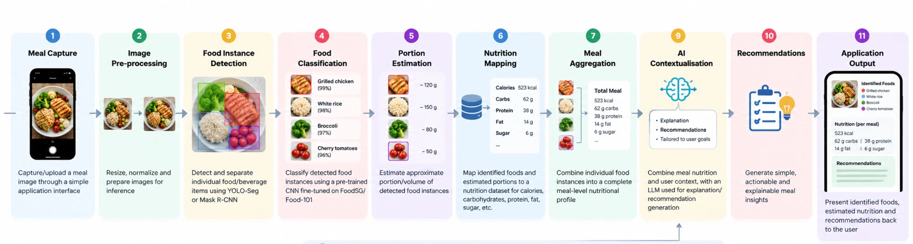

# 02 · Solution Architecture

Code map: `backend/app/services/` (pipeline stages), `backend/app/api/` (REST, OpenAPI at `/docs`), `frontend/` (React UI). See the root README for the honest-scope table.
